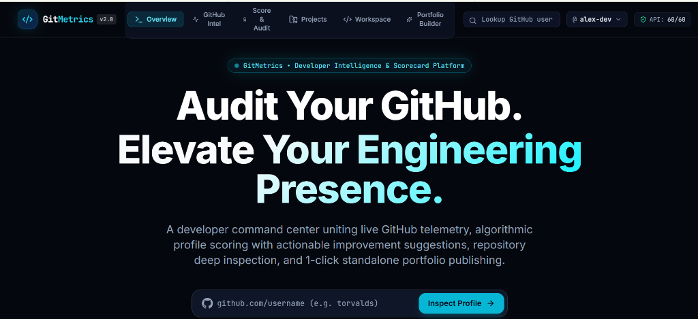
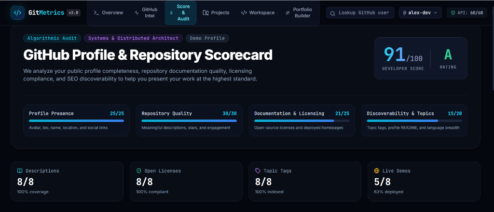
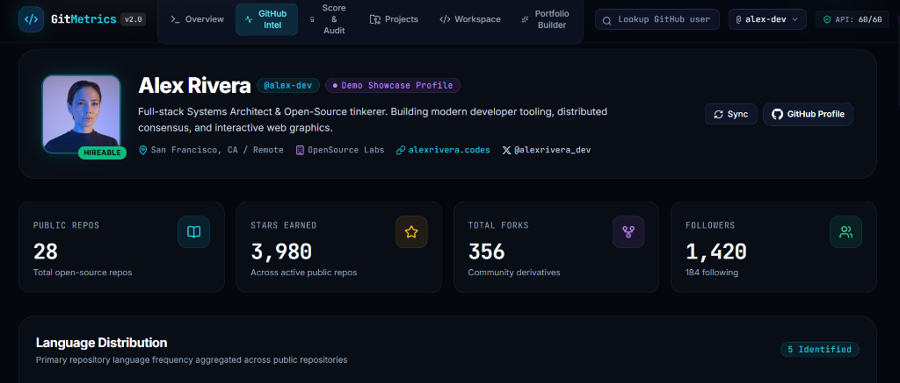
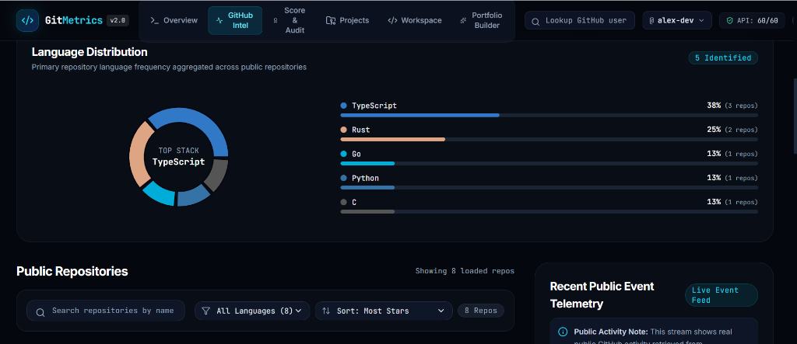
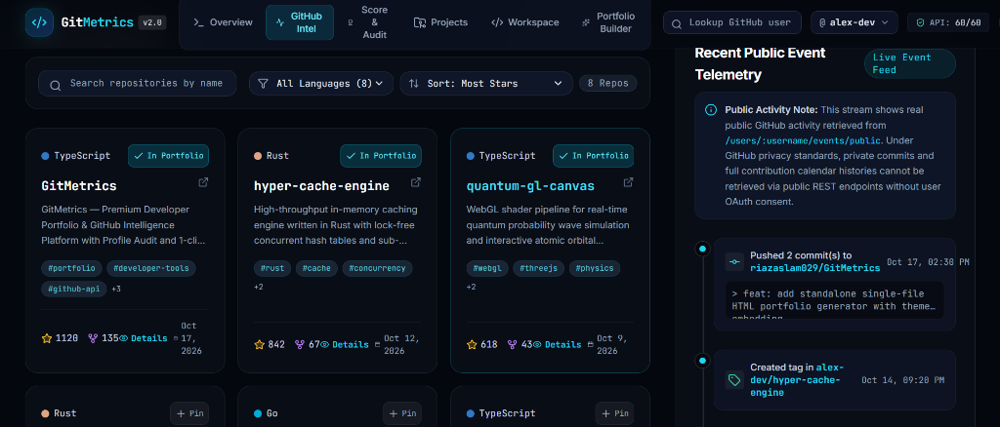

# GitMetrics 🚀
> **A Premium Developer Command Center, GitHub Intelligence Platform & 1-Click Portfolio Publisher**

[](https://gitmetrics-pink.vercel.app/)

[](https://gitmetrics-pink.vercel.app/)
[](https://github.com/riazaslam029/GitMetrics/actions)
[](LICENSE)
[](https://www.typescriptlang.org/)
[](https://react.dev/)
[](https://vitejs.dev/)
[](https://tailwindcss.com/)

🌐 **Live Production Deployment**: [https://gitmetrics-pink.vercel.app/](https://gitmetrics-pink.vercel.app/)

---

## 🌟 Overview

**GitMetrics** is an open-source web application designed for software engineering students, open-source maintainers, and independent developers. Rather than a static, one-size-fits-all portfolio template, GitMetrics operates as a personal developer command center uniting:

1. **GitHub Telemetry & Analytics**: Honest, real-time public profile and repository intelligence using GitHub REST API v3.
2. **Profile Scorecard & Audit Engine**: Automated 0–100 developer score, letter grade (A+ to D), archetype classification, and prioritized actionable improvement recommendations with direct 1-click GitHub fix links.
3. **Deep Repository Inspector**: Deep-dive modals with clone command generators (HTTPS, SSH, GitHub CLI), repository health checklists (license, topics, homepage, description), and direct GitHub deep-links.
4. **Curated Project Showcase**: High-performance 2D project explorer with instant search, category filtering, and portfolio pinning.
5. **Developer Productivity Workspace**: Personal coding milestone goals with progress trackers, weekly sprint Kanban boards, and project backlogs stored 100% locally in your browser.
6. **1-Click Standalone Portfolio Publisher**: Instant generator producing self-contained, responsive single-file `index.html` bundles ready to host on GitHub Pages, Vercel, or static hosts without any build steps.

---

## 📸 Screenshots

### 1. Developer Command Center & Hero Section


### 2. GitHub Profile & Repository Scorecard (91/100 · Grade A)


### 3. GitHub Telemetry & Public Statistics


### 4. Language Distribution & Tech Stack Breakdown


### 5. Curated Repository Matrix & Live Event Telemetry


---

## 🛠️ Architecture & Tech Stack

```
gitmetrics/
├── src/
│   ├── components/
│   │   ├── common/         # Navbar, Footer, Badges, Buttons, Modals, Lenis Smooth Scroll
│   │   ├── landing/        # HeroSection (GSAP timelines), FeatureBento, ThemeShowcase, Manifesto
│   │   ├── github/         # ProfileHeader, LanguageDistribution, RepositoryList, RepositoryDetailModal, ActivityFeed
│   │   ├── audit/          # ProfileAuditView (0-100 Scorecard, Category Health, Actionable Checklist, Markdown Report)
│   │   ├── projects/       # ProjectShowcaseView (2D Curated Explorer, Category Chips, Deep Inspection)
│   │   ├── workspace/      # GoalsTracker, WeeklyTasksBoard, BacklogManager, DataBackupPanel
│   │   └── portfolio/      # PortfolioEditor, PortfolioLivePreview (sandbox iframe), ExportPublishModal, Themes
│   ├── hooks/              # useGitHubUser, useWorkspace, usePortfolio
│   ├── services/           # githubApi (rate limits, headers), scoreService (audit scoring engine), storageService, exportService
│   ├── data/               # mockDemoData (Alex Rivera showcase dataset)
│   ├── types/              # TypeScript definitions for GitHub, Audit, Workspace, and Portfolio
│   └── test/               # Vitest & Testing Library automated test suite
```

### Technology Highlights:
- **Core**: React 19, TypeScript, Vite.
- **Styling**: Tailwind CSS with custom Modern Luxury Dark palette (`#05070E`, `#0B0F19`, `#0F1626`).
- **Smooth Physics**: Lenis smooth scroll synchronized directly to GSAP ScrollTrigger via the GSAP ticker.
- **Motion Design**: GSAP timelines with `@gsap/react` `useGSAP` hook for container-scoped animations.
- **Data Visualizations**: Recharts for responsive language distribution charts.
- **Scoring Engine**: Algorithmic profile audit evaluating profile completeness, repo documentation, license coverage, and discoverability.
- **Persistence**: Browser `localStorage` for complete client-side data privacy.
- **Testing**: Vitest, `@testing-library/react`, and `@testing-library/jest-dom`.

---

## ⚡ Quick Start & Development

### Prerequisites
- Node.js `v18.0.0` or higher
- npm `v9.0.0` or higher

### Installation

```bash
# Clone the repository
git clone https://github.com/riazaslam029/GitMetrics.git

# Navigate into the project directory
cd GitMetrics

# Install dependencies
npm install

# Start local development server
npm run dev
```

Visit `http://localhost:5173` in your browser.

---

## 🚀 Production Deployment (Vercel)

GitMetrics is deployed and active in production:
👉 **[https://gitmetrics-pink.vercel.app/](https://gitmetrics-pink.vercel.app/)**

### Continuous Deployment Workflow

1. Any changes pushed to branch `main` on GitHub automatically trigger a Vercel production deployment.
2. Pull requests generate isolated preview URLs with full SPA routing support.
3. Configured via [`vercel.json`](vercel.json) with client-side rewrites and HTTP caching.

---

## 🧪 Testing & Verification

GitMetrics includes a test suite covering API error handling, language percentage computations, LocalStorage serialization, and standalone HTML generation:

```bash
# Run Vitest test suite once
npm run test

# Validate TypeScript compilation without emitting files
npx tsc -b

# Build production bundle
npm run build
```

---

## 🌐 Deploying Your Portfolio to GitHub Pages

GitMetrics features a genuine 1-click standalone portfolio generator:

1. Open the **Portfolio Builder** tab in GitMetrics.
2. Customize your profile, skills, and theme (Neon Obsidian, Cyberpunk Emerald, Cosmic Violet, Nordic Monolith).
3. Click **Export & Deploy** &rarr; **Download index.html**.
4. Create a new GitHub repository named `<your-username>.github.io`.
5. Upload or push `index.html` to the repository root.
6. In repository **Settings** &rarr; **Pages**, select branch `main` and root `/`.
7. Your portfolio is live globally at `https://<your-username>.github.io` within 60 seconds!

---

## ⚠️ Known Limitations & API Disclaimers

1. **GitHub Unauthenticated Rate Limits**:
   - The GitHub public REST API allows up to **60 requests per hour** per IP address.
   - GitMetrics includes an optional token input (stored strictly in your browser session) to raise limits to **5,000 requests/hr**.
   - If rate limits are reached, the application provides an offline **Demo Showcase Profile** (`alex-dev`).
2. **Private Commit Calendars**:
   - In adherence to GitHub's privacy and REST API constraints, private repository commits and complete annual contribution squares are restricted from public unauthenticated API endpoints.
   - The Activity Feed honestly reflects recent public events (pushes, pull requests, and releases) from `/users/:username/events/public` rather than fabricating invented contribution graphs.
3. **Browser LocalStorage**:
   - Workspace tasks and goals belong exclusively to the current browser and do not sync across devices automatically without using the built-in **Export / Import JSON** backup feature.

---

## 🗺️ Roadmap

- [ ] GitHub OAuth integration for optional private commit contribution aggregation.
- [ ] Direct GitHub Pages automated deployment via GitHub Git API.
- [ ] Custom CSS theme generator with live color pickers.
- [ ] Export portfolio as PDF / developer resume summary.
- [ ] Interactive terminal emulator mode on standalone exported portfolios.

---

## 📄 License & Community

- **License**: Released under the [MIT License](LICENSE).
- **Contributing**: Please review our [Contributing Guide](CONTRIBUTING.md) and [Code of Conduct](CODE_OF_CONDUCT.md).
